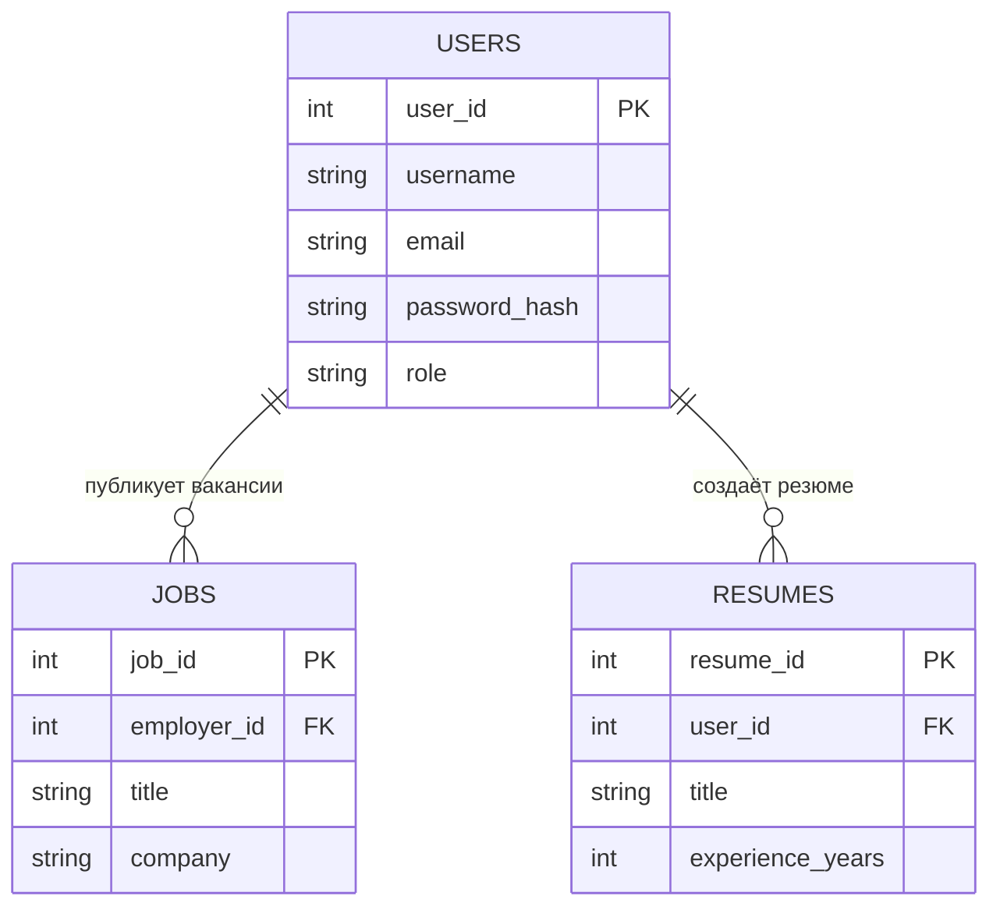

<div align="center">

# 💜 ФСП · ИТ-MATCH PRO

### Единый реестр IT-специалистов

**Специалисты, технологии и работодатели — в одном пространстве.**


[Возможности](#-возможности) · [Запуск](#-локальный-запуск) · [Структура](#-структура-проекта) · [Планы](#-планы-развития)

</div>

---

## ✨ О проекте

**FSP Platform** — веб-платформа для поиска работы и IT-специалистов в контексте спортивного программирования. Соискатель просматривает вакансии, работодатель — резюме. Личный кабинет хранит сведения о пользователе, специализации и технологиях.

Интерфейс оформлен в тёмной палитре с фиолетовыми и розовыми акцентами, плавным градиентным фоном и адаптивными карточками.

> Проект развивается поэтапно. Ниже возможности текущей версии отделены от планов; интерфейс поиска и профориентации пока не подключён к рабочей логике.

## 🚀 Возможности

| Возможность | Текущая реализация |
| --- | --- |
| Реестр вакансий | Загрузка из MySQL: компания, описание, город, зарплата и технологии |
| Реестр резюме | Загрузка из MySQL: имя, специализация, опыт, навыки и ожидаемая зарплата |
| Просмотр без аккаунта | Переключение между вакансиями и резюме |
| Регистрация | Выбор роли: соискатель или работодатель |
| Вход и выход | Авторизация по почте и паролю через Laravel Fortify, запоминание входа |
| Главная после входа | Список зависит от роли аккаунта, переключатель скрывается, появляется карточка профиля |
| Личный кабинет | Данные аккаунта и редактирование специализации, города, описания и технологий |
| Профиль работодателя | Дополнительное поле компании |
| Статистика | Количество собственных вакансий или резюме и заполненность профиля |

### 👥 Две роли

| | Соискатель | Работодатель |
| --- | --- | --- |
| Код роли | `applicant` | `employer` |
| На главной | Вакансии | Резюме |
| В профиле | Специализация, город, описание, технологии | Те же данные и название компании |
| Счётчик | Собственные резюме | Собственные вакансии |

> Заполненность профиля — доля заполненных дополнительных полей. Это не рейтинг и не подтверждение квалификации.

## 🧩 Технологии

| Слой | Технологии |
| --- | --- |
| Сервер | PHP, Laravel 13 |
| Авторизация | Laravel Fortify, сессии |
| Связь сервера и интерфейса | Inertia.js 3 |
| Интерфейс | Vue 3, TypeScript |
| Оформление | CSS, Tailwind CSS 4 |
| Сборка | Vite 8, Vite+ |
| Данные | MySQL 8 |

Laravel читает данные и проверяет запросы. Inertia передаёт их страницам Vue. Vue отображает карточки и формы, а MySQL хранит аккаунты и публикации.

## 🛠 Локальный запуск

### 1. Подготовить окружение

Нужны Git, PHP с расширениями для Laravel и `pdo_mysql`, Composer, Node.js с npm и MySQL 8. Для текущей сборки используйте Node.js 22.12+ в ветке 22 либо более новую совместимую версию. Требования PHP конкретных пакетов проверяются Composer; в используемом окружении установлен PHP 8.5.

### 2. Скачать проект и зависимости

```bash
git clone https://github.com/Alexx-Alt/FSP.git
cd FSP
composer install
npm ci
```

### 3. Создать конфигурацию

В PowerShell:

```powershell
Copy-Item .env.example .env
php artisan key:generate
```

В Linux/macOS вместо `Copy-Item` используйте `cp .env.example .env`.

Настройте `.env` под своё окружение:

```dotenv
APP_NAME="ИТ-MATCH PRO"
APP_ENV=local
APP_DEBUG=true
APP_URL=http://127.0.0.1:8000

DB_CONNECTION=mysql
DB_HOST=127.0.0.1
DB_PORT=3306
DB_DATABASE=fsp_demo
DB_USERNAME=your_mysql_user
DB_PASSWORD="your_mysql_password"

SESSION_DRIVER=file
CACHE_STORE=file
QUEUE_CONNECTION=sync
```

Замените имя и пароль MySQL своими значениями. Локальный `.env` не публикуется в Git.

### 4. Подготовить базу

Текущая версия использует собственные таблицы `users`, `jobs` и `resumes`. Они отличаются от стандартных таблиц стартового шаблона Laravel.

> **Не запускайте `composer setup`, `php artisan migrate` или `migrate:fresh` для этой схемы:** стандартные миграции ещё не адаптированы; `jobs` в шаблоне предназначена для очереди, а здесь — для вакансий.

Если готовой базы нет, выполните следующий SQL в MySQL Workbench. Он предназначен для **новой пустой базы**, не для обновления существующей.

<details>
<summary><strong>🗄 SQL: создать базу и таблицы</strong></summary>

```sql
CREATE DATABASE fsp_demo
    CHARACTER SET utf8mb4
    COLLATE utf8mb4_unicode_ci;

USE fsp_demo;

CREATE TABLE users (
    user_id INT UNSIGNED AUTO_INCREMENT PRIMARY KEY,
    username VARCHAR(50) NOT NULL UNIQUE,
    email VARCHAR(100) NOT NULL UNIQUE,
    password_hash VARCHAR(255) NOT NULL,
    role ENUM('applicant', 'employer') NOT NULL DEFAULT 'applicant',
    remember_token VARCHAR(100) NULL,
    headline VARCHAR(150) NULL,
    city VARCHAR(100) NULL,
    bio TEXT NULL,
    skills VARCHAR(255) NULL,
    company VARCHAR(100) NULL,
    created_at TIMESTAMP DEFAULT CURRENT_TIMESTAMP
) ENGINE=InnoDB;

CREATE TABLE jobs (
    job_id INT UNSIGNED AUTO_INCREMENT PRIMARY KEY,
    employer_id INT UNSIGNED NOT NULL,
    company VARCHAR(100) NOT NULL,
    title VARCHAR(150) NOT NULL,
    description TEXT NOT NULL,
    location VARCHAR(100) NULL,
    salary_min INT UNSIGNED NULL,
    salary_max INT UNSIGNED NULL,
    skills VARCHAR(255) NULL,
    created_at TIMESTAMP DEFAULT CURRENT_TIMESTAMP,
    FOREIGN KEY (employer_id)
        REFERENCES users(user_id) ON DELETE CASCADE
) ENGINE=InnoDB;

CREATE TABLE resumes (
    resume_id INT UNSIGNED AUTO_INCREMENT PRIMARY KEY,
    user_id INT UNSIGNED NOT NULL,
    title VARCHAR(150) NOT NULL,
    description TEXT NOT NULL,
    location VARCHAR(100) NULL,
    salary_expected INT UNSIGNED NULL,
    skills VARCHAR(255) NULL,
    experience_years TINYINT UNSIGNED DEFAULT 0,
    created_at TIMESTAMP DEFAULT CURRENT_TIMESTAMP,
    FOREIGN KEY (user_id)
        REFERENCES users(user_id) ON DELETE CASCADE
) ENGINE=InnoDB;
```

</details>

Новая база будет пустой. Зарегистрируйте аккаунт через интерфейс. Вакансии и резюме пока добавляются через SQL; интерфейс управления публикациями находится в планах. Пароли при регистрации хеширует модель Laravel — вручную записывать обычный пароль в `password_hash` не нужно.

### 5. Запустить приложение

Сбросить кеш конфигурации:

```bash
php artisan optimize:clear
```

В первом терминале:

```bash
php artisan serve
```

Во втором терминале:

```bash
npm run dev
```

Откройте **http://127.0.0.1:8000**. Для проверки аккаунта перейдите на `/register`, зарегистрируйтесь и заполните профиль в `/dashboard`.

## 🗂 Структура проекта

| Файл или каталог | За что отвечает |
| --- | --- |
| `routes/web.php` | Главная, получение вакансий и резюме, кабинет, сохранение профиля |
| `app/Models/User.php` | Модель пользователя, хеширование пароля, соответствие столбцам БД |
| `app/Actions/Fortify/CreateNewUser.php` | Проверка регистрации и создание аккаунта |
| `app/Providers/FortifyServiceProvider.php` | Страницы авторизации и ограничение попыток входа |
| `app/Http/Middleware/HandleInertiaRequests.php` | Общие данные страниц: текущий пользователь и статистика |
| `config/fortify.php` | Настройки авторизации |
| `resources/js/pages/Welcome.vue` | Главная и карточки вакансий/резюме |
| `resources/js/pages/Dashboard.vue` | Личный кабинет и форма профиля |
| `resources/js/pages/auth/` | Страницы входа и регистрации |
| `resources/js/components/AccessForm.vue` | Общая форма входа и регистрации |
| `resources/js/components/AccountSummary.vue` | Карточка профиля и заполненность |
| `resources/js/app.ts` | Инициализация Inertia и выбор оболочек страниц |
| `resources/css/welcome.css` | Фон, шапка, главная и реестры |
| `resources/css/access.css` | Оформление форм авторизации |
| `database/migrations/` | Миграции стартового шаблона; требуют адаптации к текущей БД |

## 🗄 Связи данных



Связи привязывают публикации к аккаунту. Роли определяют режим интерфейса; при добавлении управления публикациями понадобятся отдельные серверные проверки прав.

## 🧪 Команды разработки

| Команда | Назначение |
| --- | --- |
| `npm run dev` | Режим разработки интерфейса |
| `npm run build` | Сборка интерфейса |
| `npm run check` | Проверки форматирования и линтинга Vite+ |
| `npm run types:check` | Проверка TypeScript/Vue |
| `composer lint:check` | Проверка стиля PHP |
| `composer types:check` | Статический анализ PHP |
| `php artisan test` | Запуск тестов |
| `php artisan optimize:clear` | Очистка кешей Laravel |

Наличие команд и тестов в репозитории не означает, что все проверки проходят: тесты стартового шаблона также требуют адаптации к собственным полям пользователя.

## 🧭 Планы развития

- [x] Главная с загрузкой вакансий и резюме из БД.
- [x] Роли соискателя и работодателя.
- [x] Регистрация, вход и выход.
- [x] Личный кабинет и редактирование дополнительных данных.
- [x] Карточка профиля и счётчик собственных публикаций.
- [ ] Создание, редактирование и удаление вакансий и резюме.
- [ ] Поиск, фильтры и постраничная загрузка.
- [ ] Отклики и приглашения на вакансии.
- [ ] Проверка навыков и квалификационный профиль.
- [ ] Профориентация.
- [ ] Подтверждение почты и восстановление пароля.
- [ ] Миграции и тесты для собственной схемы данных.
- [ ] Дополнительная оптимизация анимации и адаптивности.

---

<div align="center">

**Разработчик — [Alexx-Alt](https://github.com/Alexx-Alt)**

💜 **ИТ-MATCH PRO — пространство для профессиональных возможностей.**

</div>
