<div align="center">



# ИТ-МЕТЧ

Платформа объяснимого подбора IT-специалистов в экосистеме спортивного программирования.

</div>

## Что входит в проект

- кабинеты кандидата и работодателя;
- граф знаний и evidence tree;
- квалификационное тестирование и подтверждение выбранного грейда;
- объяснимый подбор по категории, fit и подтверждённым достижениям;
- адресные приглашения и открытие контактов после принятия;
- рабочее пространство с задачами, комментариями и историей;
- аналитика кандидатов, компаний и городов;
- единая Laravel + Vue 3 кодовая база;
- две изолированные MySQL: основная и приватная;
- прикладное шифрование email, имени и телефона средствами Laravel;
- HMAC-индекс email в основной БД для безопасного поиска при входе;
- Docker-запуск локально и отдельный сетевой профиль.

## Архитектура данных

Основная база `fsp_match_v6` хранит вакансии, профили квалификации, тесты, граф знаний, матчи, приглашения и аналитику. Приватная база `fsp_match_private` хранит зашифрованные персональные данные. Порты MySQL наружу не публикуются.

## Быстрый запуск

```powershell
Copy-Item .env.example .env
npm run env:setup
docker compose up -d --build
```

Откройте `http://127.0.0.1:8000`.

Демонстрационные пользователи:

| Роль | Логин |
| --- | --- |
| Кандидат | `candidate@fsp.demo` |
| Работодатель | `employer@fsp.demo` |
| Администратор | `admin@fsp.demo` |

Пароль: `FspDemo2026!`.

## Запуск в локальной сети

Укажите в `.env` IP или домен сервера в `APP_URL`, затем:

```powershell
docker compose -f docker-compose.yml -f docker-compose.network.yml up -d --build
```

Подробности: [docs/NETWORK_DEPLOYMENT.md](docs/NETWORK_DEPLOYMENT.md).

## Документация

- [Docker и две базы](docs/DOCKER.md)
- [Сетевое развёртывание](docs/NETWORK_DEPLOYMENT.md)
- [Архитектура V6](docs/FSP_MATCH_V6.md)
- [Трассировка требований](docs/REQUIREMENTS_TRACE_V6.md)
- [OpenAPI](docs/openapi.yaml)

## Технологии

Laravel 13, PHP 8.3+, Inertia.js, Vue 3, TypeScript, Vite, MySQL 8.4, Docker Compose и Nginx.

Название продукта: **ИТ-МЕТЧ**. Визуальная айдентика использует официальный логотип, палитру (#402FFF, #EC1D35, #EDEDED, #1B1C21) и JetBrains Mono из брендбука ФСП.
